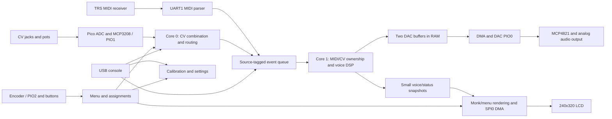

# Lamarama

Lamarama is a Raspberry Pi Pico 2 based, monophonic vocal synthesizer module inspired by AudioNerdz's **Delay Lama**. It combines a formant-wave-function voice with MIDI, a dedicated pitch/gate/vowel interface, four assignable pots, four assignable CV inputs, and a small LCD showing the animated monk and setup menus.

The Pico runs the user interface and control acquisition on one core and audio synthesis on the other. PIO handles the DAC serial timing, external ADC transactions, and rotary encoder. DMA moves audio samples and LCD pixels without requiring the CPU to transmit individual bits or bytes.

**Current status:** firmware bring-up is working on a bare Pico 2, including the USB console, audio-buffer scheduling, and timing measurements. The module PCBs are in production. Analog audio output, converter accuracy, physical controls, and LCD operation on the assembled module still need board-level verification. This document describes the implemented design rather than claiming completed hardware qualification.

## Contents

- [Hardware organization](#hardware-organization)
- [Signals and pin assignments](#signals-and-pin-assignments)
- [Firmware architecture](#firmware-architecture)
- [Playing and control ownership](#playing-and-control-ownership)
- [Display and menus](#display-and-menus)
- [Calibration and saved settings](#calibration-and-saved-settings)
- [Build and upload](#build-and-upload)
- [USB console](#usb-console)
- [Debugging and timing](#debugging-and-timing)
- [Source-code map](#source-code-map)
- [Tests and bring-up](#tests-and-bring-up)
- [Credits and licensing](#credits-and-licensing)

## Hardware organization

The current electrical designs are under [`hw/main`](hw/main) and [`hw/control`](hw/control). The [`hw/fp`](hw/fp) directory contains the front-panel design, and [`hw/gerbers`](hw/gerbers) contains fabrication outputs. Open the board-specific KiCad projects when tracing the current circuits.

| Assembly | Main responsibilities | Design files |
| --- | --- | --- |
| Main board | Pico 2, MCP4821 DAC, MCP3208 ADC, 3.0 V references, reference buffering, power conversion, LCD and control-board connectors | [Schematic](hw/main/main.kicad_sch), [PCB](hw/main/main.kicad_pcb) |
| Control / I/O board | CV and gate jacks, pots, encoder and buttons, MIDI input receiver, analog input conditioning, audio output stage | [Schematic](hw/control/control.kicad_sch), [PCB](hw/control/control.kicad_pcb) |
| Front panel | Mechanical layout and panel artwork | [Front-panel files](hw/fp) |

### Power and references

The module uses the modular-synth power rails, with local low-voltage supplies for the digital electronics. The main-board LMR50410 provides local power conversion; the Pico uses its 3.3 V logic domain. The analog control circuitry includes TL074 op-amps and uses the analog supply rails.

Separate **LM4040C30 3.0 V references** serve the Pico ADC and external ADC domains. Reference buffering is provided on the main board. The two references are nominally the same voltage but have separate calibration records in firmware. Pico `ADC_VREF` is physical pin 35, and `AGND` is pin 33.

The GPIO signals listed below are logic-level connections after the module's input conditioning. The analog circuitry converts jack voltages to the ADC ranges and the gate comparator produces a logic signal.

### Audio output

The **MCP4821** is a single-channel 12-bit DAC. Firmware converts signed floating-point audio to 12-bit unsigned codes and sends a 16-bit command with active output and 1x gain (`0x3000 | sample`). The DAC uses its own internal 2.048 V reference. Its output passes to the control-board analog output circuitry and audio jack.

The DAC is write-only in this design: successful DMA completion proves that firmware transmitted data, not that the DAC is present or that the audio jack has the intended signal. Confirm actual waveform and output level on the assembled hardware.

### Analog inputs

There are **eleven acquired analog channels**:

| Converter channel | Physical control | Firmware behavior |
| --- | --- | --- |
| Pico ADC0 / GP26 | Frequency CV | Dedicated 1 V/oct pitch path |
| Pico ADC1 / GP27 | Vowel CV | Added to the dedicated vowel-pot position |
| Pico ADC2 / GP28 | Vowel pot | Dedicated vowel-position control |
| MCP3208 CH0–3 | Pots 1–4 | Independently assignable in the menu |
| MCP3208 CH4–7 | CV inputs 1–4 | Independently assignable in the menu |

The dedicated frequency and vowel CV circuits scale unipolar jack voltage by **0.6** before the ADC. Nominally, 0–5 V at those jacks becomes 0–3 V at the ADC. The assignable MCP CV circuits use an offset and gain: nominally **ADC voltage = 1.5 V + 0.3 × jack voltage**, accommodating a bipolar input range around zero. The pot signals are referenced to the buffered control reference.

The Pico ADC hardware performs single-shot conversions. A PIO state machine clocks the MCP3208 at **500 kHz**, using one 24-clock transaction per channel. Core 0 schedules and collects both converters without blocking for conversions. A complete eleven-channel scan is started no more often than once per millisecond; actual cadence also depends on main-loop service time.

Snapshots expose raw counts and calibrated 0–1 readings. Raw update callbacks identify the converter, channel and fresh 12-bit value. Acquisition itself does not assign external channels to voice parameters.

### Gate, MIDI and controls

- The gate jack is conditioned by an **LM393** comparator. The resulting Pico input is **active low**, with a pull-up. Firmware polls it without the button-style debounce delay.
- The **TRS MIDI input** uses the board's **6N138** receiver, then feeds UART1 RX at 31,250 baud. Jack wiring and signal conditioning are defined by the control schematic.
- Encoder A/B are counted continuously by PIO. The encoder's separate push switch is **OK**, and the separate pushbutton is **Back**. Those switches use pull-ups and 20 ms software debounce.
- The **240 × 320 ST7789 LCD** uses hardware SPI0 and DMA, with separate chip-select, D/C, reset and backlight signals.

## Signals and pin assignments

These are **GPIO numbers**. The physical Pico header pin is included to avoid confusing the two numbering systems.

| GPIO | Pico header pin | Signal | Owner |
| --- | --- | --- | --- |
| GP0 | 1 | Probe diagnostic TX | UART0 TX only |
| GP1 | 2 | LCD CS | Core 0 GPIO |
| GP2 | 4 | LCD SCK | SPI0 |
| GP3 | 5 | LCD MOSI / SDA label | SPI0 |
| GP4 | 6 | LCD D/C | Core 0 GPIO |
| GP5 | 7 | LCD reset | Core 0 GPIO |
| GP6 | 9 | LCD backlight | Core 0 GPIO, on/off |
| GP7 | 10 | MCP3208 CS | PIO1 |
| GP8 | 11 | MCP3208 CLK | PIO1 |
| GP9 | 12 | MCP3208 DIN | PIO1 |
| GP10 | 14 | MCP3208 DOUT | PIO1 |
| GP11 | 15 | MCP4821 CS | PIO0 |
| GP12 | 16 | MCP4821 SCK | PIO0 |
| GP13 | 17 | MCP4821 SDI | PIO0 |
| GP14 | 19 | MCP4821 LDAC | PIO0 |
| GP15 | 20 | Unused | — |
| GP16 | 21 | Encoder A | PIO2 |
| GP17 | 22 | Encoder B | PIO2 |
| GP18 | 24 | Encoder OK switch | Core 0 GPIO |
| GP19 | 25 | Back switch | Core 0 GPIO |
| GP20 | 26 | Gate, active low | Core 0 GPIO |
| GP21 | 27 | MIDI RX | UART1 |
| GP22 | 29 | Spare | — |
| GP26 | 31 | FREQ_CV / ADC0 | Pico ADC |
| GP27 | 32 | VOWEL_CV / ADC1 | Pico ADC |
| GP28 | 34 | VOWEL_POT / ADC2 | Pico ADC |
| GP25 | Onboard LED, not a header pin | Audio-loop heartbeat | Core 1 GPIO |

The active pin definitions live in the corresponding peripheral headers. Historical generic SPI/I2C definitions in `lama.h` are template leftovers, not the current peripheral pin map.

## Firmware architecture



### Core 0: acquisition and interface

`main()` initializes the event queue, menu/defaults, saved settings, controls, MIDI, analog acquisition and audio core, then starts the display and console. Its loop services:

1. MIDI UART input.
2. Encoder and debounced buttons.
3. ADC scans and dedicated CV/pot combination.
4. Menu state and incremental LCD rendering.
5. Deferred settings saves.
6. Probe UART diagnostics and USB console input/output.

Core 0 never directly edits the live voice. It sends source-tagged events to a bounded, multicore-safe queue. Audio and status snapshots are copied under short locks. A queue overflow releases note ownership to recover from a potentially lost Note Off; fresh CV gate status can resume CV playing.

### Core 1: audio

Core 1 owns the voice and audio-buffer producer. For each free DAC buffer it processes events, updates control ownership, renders floating-point samples, applies level compensation/smoothing, packs DAC commands and submits the buffer.

The default is **44.1 kHz with 256 samples per buffer**, giving about **5.8 ms** per block. Events affect the next render boundary. The PIO clock-divider rounding produces about 44,104.7 samples/second at the 150 MHz system clock. The diagnostic budget uses the actual divider.

The voice uses overlapping formant-wave-function grains, vowel-interpolated formants, aspiration, vibrato, glide and an envelope. Exact-input caches reuse pitch conversion, vibrato scaling and unchanged grain waveforms. Grain triggers still accumulate the waveform at the original times.

The onboard LED toggles every 100 completed buffer fills, about once every 0.58 seconds at 44.1 kHz. It indicates progress through the audio loop; it is not an audio-output detector.

### DAC buffer ownership

Two 256-word DAC buffers cycle through **FREE → FILLING → READY → PLAYING → FREE**. Both initial buffers are rendered before playback starts.

PIO supplies the sample clock and CS/SCK/SDI/LDAC sequence. A single DMA channel, paced by PIO's TX DREQ, feeds complete buffers. Its completion interrupt releases the consumed RAM buffer and starts the next ready one. The joined PIO FIFO bridges the interrupt handoff.

A RAM buffer can be released once DMA has copied its final word into the FIFO, even though those final samples have not finished playing. The CPU never refills a DMA-owned buffer. If the producer falls behind, PIO finishes the queued samples and holds the last DAC output until a ready buffer arrives.

### Peripheral allocation

| Resource | Use |
| --- | --- |
| PIO0, one state machine | MCP4821 output, 256 PIO cycles per sample |
| PIO1, one state machine | MCP3208 serial transactions |
| PIO2, one state machine | Encoder state table and cumulative edge count |
| One DMA channel, IRQ1 on core 1 | DAC buffer transmission/completion |
| One DMA channel, polled on core 0 | LCD pixel transmission |
| SPI0 | LCD, initially 12.5 MHz |
| UART1 | MIDI input, 31,250 baud, 8N1 |
| UART0 TX | Probe diagnostics, 115,200 baud, 8N1 |
| USB CDC | Interactive console and SDK USB reset interface |

The encoder program is placed at PIO2 address zero because it uses computed jumps. It keeps a wrapping count in PIO while the CPU is busy; the CPU drains cumulative snapshots roughly once per millisecond. Four quadrature edges form one menu detent by default.

## Playing and control ownership

### Dedicated CV playing

Frequency CV and gate work without a menu assignment or MIDI connection. The nominal mapping is **1 V/oct**, with **MIDI note 36 / C2 as the 0 V target**. The current CV pitch and gate state remain tracked while MIDI is playing.

The dedicated vowel control is:

```text
pot_offset = 2 * calibrated_pot_position - 1
vowel = clamp(0.5 + 0.5 * pot_offset + 0.1 * vowel_cv_volts, 0, 1)
```

The pot's center is zero offset, which corresponds to the voice's midpoint vowel of 0.5. With zero CV, full left/center/right select 0/0.5/1. Positive vowel CV adds modulation: 1 V adds 0.1 and 5 V adds 0.5. This dedicated CV input is unipolar; its circuit cannot measure negative modulation like the offset MCP CV inputs can. Depth constants are in `vowel_controls.h`.

### MIDI

MIDI channel **1** is selected at build time in `midi.h`. Supported messages are:

| Message | Behavior |
| --- | --- |
| Note On / Off | Monophonic, last-note priority; releasing the newest held note restores the previous one |
| Note On with velocity zero | Note Off |
| Pitch wheel | Vowel, following the classic Delay Lama mapping |
| CC1 | Vibrato depth |
| CC5 | Glide |
| CC7 | Level |
| CC13 | Voice character |
| CC120 / CC123 / System Reset | Release MIDI notes and restore CV ownership |

The parser supports running status and interleaved real-time messages. SysEx and unsupported messages are ignored. Velocity is passed to the voice API, but the current voice implementation does not use it to scale amplitude. Delay/CC12, sustain-pedal behavior and active-sensing timeout handling are not implemented.

### MIDI priority and handback

- Held MIDI notes own pitch and gate. CV changes cannot retune or stop them.
- Releasing the final MIDI note restores the current CV pitch/gate pair: gate high resumes CV, gate low releases the voice.
- MIDI controller updates own only their parameter, for two seconds after its last MIDI update. Other panel controls continue working.
- ADC updates are cached during that ownership period. After expiry, a 100 ms ramp returns to the latest ADC value. Without an ADC source, the MIDI value remains.
- Among panel sources targeting the same parameter, the most recently changed source wins. External pitch assignments share the panel pitch with the dedicated frequency CV. No additive summing or soft takeover is implemented for generic assignments.

Unplugging MIDI during a held note does not manufacture a missing Note Off. `off` in the console releases the MIDI note stack while leaving the CV path available.

## Display and menus

The upper **240 × 224 pixels** show the monk; the lower **240 × 96 pixels** show setup menus. The existing artwork consists of 30 packed 120 × 112, 4-bit palette frames. Build tooling embeds them unchanged in flash, using **201,632 bytes** including the palette.

Core 0 expands one source row per main-loop pass into a reusable **107,520-byte RGB565 RAM buffer**, scaling each pixel 2×. DMA sends the selected image through SPI0. The same buffer is reused for menu redraws when no transfer owns it. CS stays asserted until both DMA and the SPI shifter finish. Unchanged frames/menu views are skipped.

At the initial SPI speed, a monk image takes about 69 ms to transmit, allowing roughly 14 frames/sec before other overhead. Active notes select frames 6–29 by vowel. Idle mode follows the hold/blink/shuffle sequence. Display startup delays use deadlines rather than sleeping through the control loop.

### Setup interaction

Turn the encoder to select an entry, press **OK** to enter/edit/accept, and use **Back** to cancel or move up. Setup contains:

- **Input assignments:** eight inputs, four rows per page; select an input and its destination.
- **ADC calibration:** select Pico ADC or MCP3208 and follow the voltage-capture prompts.
- **Save settings:** explicitly persist accepted changes.
- **Reset defaults:** restore unassigned external inputs and nominal calibration in RAM; save separately to retain the reset.

Destinations are Off, Pitch, Vowel, Voice, Vibrato, Vibrato rate, Glide, Aspiration, Level, Attack, Decay, Sustain and Release. Most destinations map calibrated 0–1 input to 0–1 parameter values. Generic Pitch spans MIDI notes 36–84; Attack/Decay span 0–2 seconds, and Release 0–4 seconds.

Small input fluctuations are suppressed and generic updates are rate-limited to one per input per 20 ms. Dedicated vowel updates have their own smaller change threshold and 5 ms rate limit. Encoder direction, detent behavior and debounce still need checking on the actual controls.

## Calibration and saved settings

Each converter has **one shared calibration**, applied to all of its channels. Calibration uses its reference jack's known conditioning to fit ADC-pin voltage:

| Menu choice | Apply reference voltage here | ADC voltage at jack 1 V / 4 V |
| --- | --- | --- |
| Pico ADC | FREQ CV, ADC0 | 0.6 V / 2.4 V |
| MCP3208 | CV 1, CH4 | 1.8 V / 2.7 V |

Apply a stable **1.000 V**, let it settle and press OK; repeat with **4.000 V**. Each capture averages the next 64 reference-channel readings. The wizard rejects noisy, near-rail, reversed or implausible captures. Review and accept to apply the new bank calibration, then choose **Save settings** to make it persistent.

A shared calibration corrects the converter/reference path as measured through that reference input; it does not individually characterize every channel's resistors. Snapshots retain raw 12-bit readings alongside corrected, clamped 0–1 values.

Settings contain all eight external assignments and both calibrations. They use two alternating 4 KiB sectors at flash offsets **0x3FE000 and 0x3FF000**, the last 8 KiB of the Pico 2's 4 MiB flash. A versioned 256-byte record contains a sequence number and CRC32. A save writes and verifies the alternate sector, retaining the previous valid record. Boot loads the newest valid record or defaults. Version 1 settings migrate with nominal MCP calibration; new saves use version 2.

Unchanged saves avoid writing flash. The build and runtime guard against firmware overlapping the reserved sectors. Normal firmware updates can preserve those sectors; a full-chip erase clears settings.

Saving deliberately permits a brief audio/control interruption. The SDK locks out core 1 and disables interrupts while flash is unavailable. Writes wait until display startup has completed and display DMA is idle. Audio DMA/PIO can drain and stall during that operation, then recover. Underruns associated with a save are expected.

## Build and upload

### Tools

- Raspberry Pi Pico SDK **2.3.1**.
- Arm GNU toolchain; the checked-in VS Code setup uses **15_2_Rel1**.
- CMake **3.13+**, Ninja or another supported generator, and Python 3.
- `picotool` for SDK output generation/upload; the VS Code setup uses **2.3.1**.
- Optional: Raspberry Pi Pico VS Code extension, Debug Probe/OpenOCD/GDB, and clang-format.

The CMake project imports an installed SDK and defaults to board `pico2`. The firmware includes its own packed artwork, so the MonkSynth submodule is useful for reference but is not a build dependency. Repository submodule configuration currently uses an SSH URL.

Run these commands from **`src/lama`**:

```sh
export PICO_SDK_PATH=/path/to/pico-sdk
cmake -S . -B build -G Ninja -DPICO_BOARD=pico2 -DCMAKE_BUILD_TYPE=Release
cmake --build build -j4
```

Ensure the Arm compiler and build tools are available on PATH, or provide `PICO_TOOLCHAIN_PATH` / `CMAKE_MAKE_PROGRAM`. The VS Code extension's installed tool paths are already configured under `.vscode`.

| Build setting | Default | Purpose |
| --- | --- | --- |
| `PICO_BOARD` | `pico2` | RP2350, non-wireless board and direct onboard LED |
| `LAMA_SAMPLE_RATE` | `44100` | Nominal audio rate; integer 8000–48000 |
| `LAMA_USB_CONSOLE` | `ON` | USB CDC console and SDK USB reset support |
| `LAMA_AUDIO_DEBUG` | `ON` | Once-per-second probe UART summaries |
| `SAMPLE_BUFFER_SIZE` | `256` in `lama.h` | Audio block size; rebuild required |

44.1 kHz is the primary target. Alternative rates can be selected with `-DLAMA_SAMPLE_RATE=32000` or `22050`; preserve the matching ELF when debugging a different build. Source stepping may be easier with a Debug build, but remeasure timing at the optimization level used for playback.

Outputs are `build/lama.uf2` for BOOTSEL upload, `build/lama.elf` for source debugging, `build/lama.bin` for the flash payload, and the linker map for size inspection. UF2 packaging is roughly twice the payload size. ELF debug information is not all programmed into flash.

### Upload without a probe

Hold **BOOTSEL** while connecting USB. Release it when the **RP2350** drive appears, then copy `build/lama.uf2` to it. The board restarts into firmware. Once this USB-enabled firmware is running, the SDK reset interface also supports subsequent picotool/Run Project uploads. Hardware BOOTSEL remains the recovery path.

### Source debugging and probe logs

Connect the probe's SWD interface to Pico SWCLK/SWDIO/GND for breakpoints, memory/register inspection and flashing. For diagnostic text, connect **Pico GP0 → probe UART RX** and ground; leave probe TX disconnected because **GP1 is LCD CS**, not debug RX. Open the probe UART at **115200, 8N1, no flow control**.

The native Pico USB console is separate from that UART. The existing `.vscode` OpenOCD paths include `openocd.exe`; confirm the executable path for the host OS before using those debug tasks.

Breakpoints and flash saves disturb audio timing. Use the running console, counters and timing measurements to investigate real-time behavior without intentionally stopping the audio core.

## USB console

Connect with a live serial terminal such as minicom, or a serial monitor configured to send messages with **LF or CRLF**. **115200, 8N1, no flow control** is conventional; USB CDC is not paced by the selected UART baud. The console echoes input, so disable local echo. It greets with `lama USB console. Type help.`

```text
help
info
note 69
resetstats
status
adc
set vowel 0.7
set vibrato 0.2
off
connections
routes
assign 0 vibrato
cal
save
```

| Command | Purpose |
| --- | --- |
| `help` | Command syntax and parameter ranges |
| `info` | Board, clock, nominal rate, peripherals and settings state |
| `status` | Note/vowel state, audio counters, timings and worst-block context |
| `resetstats` | Clear the audio measurement window at the next buffer boundary, preserving playback |
| `connections` | Separate transmitter/acquisition activity from unverified external device presence |
| `adc` | All eleven raw/calibrated readings, scan sequence and age |
| `note NOTE [VELOCITY]` | MIDI-style test note, values 0–127, default velocity 100 |
| `off [NOTE]` | Release one or all MIDI notes; high CV gate can still play |
| `set PARAM VALUE` | MIDI-priority parameter update; two-second ownership and normal handback apply |
| `routes` | Show the eight external assignments |
| `assign INPUT TARGET` | Change an assignment in RAM; inputs 0–3 are pots, 4–7 are CV |
| `cal` | Inspect the two calibration records |
| `save` | Request persistence; inspect `info` for completion |

`set` parameters are `vowel`, `voice`, `vibrato`, `vib_rate`, `glide`, `aspiration`, `level`, `attack`, `decay`, `sustain` and `release`. Values are 0–1 except Attack/Decay 0–2 seconds and Release 0–4 seconds. Assignment targets additionally include `off` and `pitch`.

The console runs on core 0 with bounded input/output work, buffered replies and USB backpressure. It accepts lines up to 95 characters, supports backspace and Ctrl-C line cancellation, and rejects malformed/non-finite/out-of-range numbers. Closing the terminal does not automatically release a held test note. There is no command history or arbitrary memory access.

MCP4821 and the TX-only LCD wiring have no readback. MCP3208 transactions have no device ID/ACK. An absent ADC and grounded inputs can both produce zeros. `connections` reports evidence such as rail readings, MIDI traffic and GPIO/encoder activity without claiming a verified chip connection.

## Debugging and timing

The primary measurement is **worst-case buffer fill time**, not just its average. At 44.1 kHz, keep complete work below the approximately 5804 µs measured block budget.

| Field | Meaning |
| --- | --- |
| `blocks` | Buffers rendered/submitted in this measurement window |
| `A/B` | Completed DMA transfers for each RAM buffer |
| `late` | Next buffer was not ready when DMA finished; FIFO may still cover the delay |
| `underrun` | Observed sticky PIO TXSTALL episodes; real FIFO starvation, not a missing-sample count |
| `fill last/avg/max` | Message handling + rendering + packing/submission; excludes waiting for a free buffer |
| `slow` | Fill times exceeding the configured block budget |
| `messages/render/pack` | Per-stage timings; pack includes submission |
| `grains/builds` | Grain triggers versus actual waveform rebuilds |
| `worst fill phases` | Stage times and grain counts from the single worst-fill block |
| `stats window` | Increments when `resetstats` is serviced by core 1 |

Stage maxima can come from different blocks. A fresh reset leaves the note/envelope, voice caches and buffer ownership untouched. An in-flight DMA transfer may complete after the reset, so its completion belongs to the new window. Counter snapshots update after the next completed fill.

In bare-Pico testing at 150 MHz/44.1 kHz, one sustained-note run reported approximately **1836 µs average / 3240 µs maximum**, with zero late buffers, underruns or over-budget blocks over 38,207 rendered buffers. Additional modulation testing was reported around 3300 µs. These are observed bring-up results, not guarantees for every pitch or fully wired control workload.

The optimization's host comparison produced **356,580 byte-identical samples** across multiple rates and parameter/envelope changes. The firmware still needs combined hardware stress tests: pitch changes, vowel motion, menu redraws, MIDI traffic and analog-input noise. Floating unconnected inputs can change controls during a nominally steady note.

## Source-code map

Paths below are relative to the firmware directory, `src/lama`.

| Files | Responsibility |
| --- | --- |
| [`lama.c`](src/lama/lama.c), [`lama.h`](src/lama/lama.h) | Startup, main-loop order, ADC callback integration, block/rate defaults |
| [`soundCore.c`](src/lama/soundCore.c), [`soundCore.h`](src/lama/soundCore.h) | Audio core, floating-point scratch buffer, gain smoothing, DAC packing, heartbeat and timing snapshots/reset requests |
| [`voice.c`](src/lama/voice.c), [`voice.h`](src/lama/voice.h) | MonkSynth-derived FOF DSP, tables, envelope, pitch utilities and exact-input caches |
| [`voice_control.c`](src/lama/voice_control.c), [`voice_control.h`](src/lama/voice_control.h) | Audio-side note stack, MIDI/CV priority, cached panel values and controller handback |
| [`messenger.c`](src/lama/messenger.c), [`messenger.h`](src/lama/messenger.h) | Bounded multicore event queue and source tagging |
| [`dac.c`](src/lama/dac.c), [`dac.h`](src/lama/dac.h), [`dac.pio`](src/lama/dac.pio) | Buffer ownership, DMA completion/restart, DAC wire timing and stall counters |
| [`input.c`](src/lama/input.c), [`input.h`](src/lama/input.h), [`mcp3208.pio`](src/lama/mcp3208.pio) | Nonblocking eleven-channel scans, snapshots, calibration application and raw update callback |
| [`cv_input.c`](src/lama/cv_input.c), [`cv_input.h`](src/lama/cv_input.h), [`cv_pitch.c`](src/lama/cv_pitch.c) | Dedicated pitch/vowel ADC dispatch, gate polling/status heartbeat and volts-to-note conversion |
| [`vowel_controls.c`](src/lama/vowel_controls.c), [`vowel_controls.h`](src/lama/vowel_controls.h) | Dedicated pot/CV combination, thresholds and update rate limit |
| [`routing.c`](src/lama/routing.c), [`routing.h`](src/lama/routing.h) | Eight menu assignments, ranges and generic input-change suppression |
| [`calibration.c`](src/lama/calibration.c), [`calibration.h`](src/lama/calibration.h) | Per-converter voltage fit, normalized conversion and reference-sample capture |
| [`midi.c`](src/lama/midi.c), [`midi.h`](src/lama/midi.h), [`midi_uart.c`](src/lama/midi_uart.c) | Byte-stream parser, supported message mapping, UART1 polling/error recovery and traffic counters |
| [`display.c`](src/lama/display.c), [`display.h`](src/lama/display.h) | ST7789 startup state machine, display-buffer ownership, LCD windows and SPI DMA |
| [`monk.c`](src/lama/monk.c), [`monk.h`](src/lama/monk.h) | Frame choice, idle animation and incremental 4bpp-to-RGB565 expansion |
| [`menu.c`](src/lama/menu.c), [`menu.h`](src/lama/menu.h), [`menu_font.h`](src/lama/menu_font.h) | Setup navigation/edit/cancel states, calibration/save flows and row rendering |
| [`ui_controls.c`](src/lama/ui_controls.c), [`ui_controls.h`](src/lama/ui_controls.h), [`encoder.pio`](src/lama/encoder.pio) | Encoder PIO configuration, bounded snapshot polling and OK/Back debounce |
| [`encoder_steps.c`](src/lama/encoder_steps.c), [`encoder_steps.h`](src/lama/encoder_steps.h) | Modular edge-count differences, partial steps and detent conversion |
| [`settings.c`](src/lama/settings.c), [`settings.h`](src/lama/settings.h) | Load/save policy, dirty tracking, defaults and deferred save requests |
| [`settings_format.c`](src/lama/settings_format.c), [`settings_format.h`](src/lama/settings_format.h) | Versioned record encoding, validation, CRC and migration |
| [`settings_flash.c`](src/lama/settings_flash.c), [`settings_storage.h`](src/lama/settings_storage.h) | Physical flash adapter, reserved sectors, RAM program buffer and safe multicore execution |
| [`usb_console.c`](src/lama/usb_console.c), [`usb_console.h`](src/lama/usb_console.h) | USB terminal transport, line editing, replies and command execution on core 0 |
| [`console_command.c`](src/lama/console_command.c), [`console_command.h`](src/lama/console_command.h) | Hardware-independent parsing, command vocabulary and input validation |
| [`audio_debug.c`](src/lama/audio_debug.c), [`audio_debug.h`](src/lama/audio_debug.h) | Bounded UART0 diagnostic output |
| [`assets/`](src/lama/assets) | Packed monk frames, palette, format notes and font license |
| [`tools/embed_monk.py`](src/lama/tools/embed_monk.py) | Build-time packed asset embedding into generated C |
| [`tools/check_flash_size.py`](src/lama/tools/check_flash_size.py) | Reject an image overlapping settings sectors |
| [`tools/format_code.py`](src/lama/tools/format_code.py), [`.clang-format`](src/lama/.clang-format) | Microsoft/Allman formatting and blank lines after completed blocks |
| [`CMakeLists.txt`](src/lama/CMakeLists.txt), [`pico_sdk_import.cmake`](src/lama/pico_sdk_import.cmake) | Sources, SDK/peripheral libraries, PIO headers, options and output generation |
| [`tests/`](src/lama/tests) | Host logic tests, flash-memory model, PIO simulators and waveform comparison fixture |
| [`notes.md`](src/lama/notes.md) | More detailed implementation and bring-up notes |

`build/monk_assets.c` and the `.pio.h` files are generated. `build/` can be recreated; source assets and tools are required. Older experiments and extraction/prototype code elsewhere in `src` are not current firmware build inputs.

## Tests and bring-up

Host tests exercise behavior without connected converters or a probe. For example, from `src/lama` with a host C compiler:

```sh
cc -std=c11 -Wall -Wextra -Werror -fsanitize=address,undefined -I. \
    console_command.c tests/test_console_command.c -lm -o /tmp/lama-test-console
/tmp/lama-test-console

cc -std=c11 -Wall -Wextra -Werror -fsanitize=address,undefined -I. \
    calibration.c settings_format.c settings.c routing.c voice.c \
    tests/settings_memory.c tests/test_settings.c -lm -o /tmp/lama-test-settings
/tmp/lama-test-settings

cc -std=c11 -Wall -Wextra -Werror -fsanitize=address,undefined -I. \
    menu.c routing.c calibration.c settings_format.c settings.c voice.c \
    tests/settings_memory.c tests/test_menu.c -lm -o /tmp/lama-test-menu
/tmp/lama-test-menu

python3 tests/test_dac_pio.py
python3 tests/test_mcp3208_pio.py
python3 tests/test_encoder_pio.py
```

Other tests cover MIDI parsing, voice ownership/handback, dedicated vowel controls, cache invalidation, monk decoding/animation and encoder detent/wrap logic. `settings_memory.c` simulates flash failures, CRC corruption and interrupted writes. `render_voice_samples.c` is a differential waveform fixture. More commands and test details are in [`notes.md`](src/lama/notes.md).

A practical board bring-up sequence is:

1. Check supply/reference rails and Pico programming/console access.
2. Confirm DAC CS/SCK/SDI/LDAC timing and actual analog output with a test note.
3. Inspect ADC readings while moving each pot and applying known voltages; verify physical channel order and calibrate.
4. Verify gate polarity, pitch tracking, vowel combination and MIDI/CV handover.
5. Confirm LCD orientation/colors, knob direction/detents, and OK/Back behavior.
6. Save settings, restart, verify restoration, and test recovery under controlled conditions.
7. Run sustained combined audio/control/display load, reset timing statistics, and check worst-case headroom and underruns.

Known limits include sequential rather than simultaneous ADC sampling, polling-based gate capture, no generic CV summing/soft takeover, no MIDI sustain/active-sensing watchdog, and no automatic external-chip presence detection. Settings writes intentionally interrupt real-time operation. Physical output level, calibration accuracy, switch behavior and long-run timing remain hardware-validation items.

## Credits and licensing

- **Dave Hamilton:** Lamarama hardware and module project; see the repository [MIT license](LICENSE).
- **Jonathan Taylor / [MonkSynth](https://github.com/JonET/monksynth):** original C voice engine. `voice.c` and `voice.h` retain the copyright, full MIT notice and upstream attribution, with local adaptations described in their headers.
- **Xavier Rodet / IRCAM:** formant-wave-function synthesis technique, as credited by MonkSynth.
- **AudioNerdz / Delay Lama (2002):** original instrument inspiration and the source of the monk artwork used by the prototype. Artwork provenance is documented in the assets and extraction tools; a separate artwork license is not included here.
- **st7789_mpy / Russ Hughes and contributors:** earlier display prototype and reused bitmap font; its notice is preserved in [`assets/font-LICENSE.txt`](src/lama/assets/font-LICENSE.txt).
- **Raspberry Pi Pico SDK and examples:** peripheral support and reference approaches, including cumulative PIO encoder counting. SDK components retain their own licenses.
